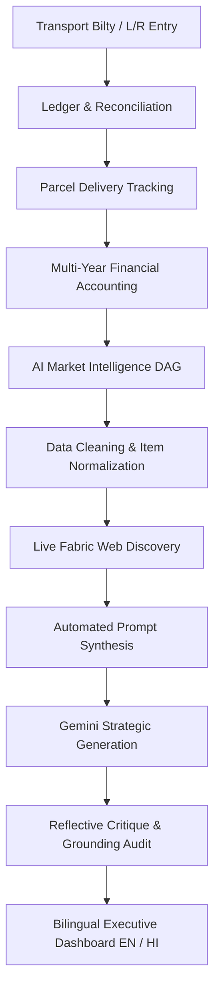

# CashCenter — Wholesale Textile Operations & Market Intelligence

[](https://github.com/phantomhieve/cashcenter/actions/workflows/ci.yml)
[](https://www.python.org/)
[](https://www.djangoproject.com/)
[](https://www.postgresql.org/)
[]()

CashCenter is an enterprise operational data management and market intelligence system built specifically for wholesale textile and fabric merchant operations in North Bihar (Bara Bazar, Darbhanga). It combines multi-year financial ledger accounting with a 5-node AI Directed Acyclic Graph (DAG) pipeline powered by Google Gemini, delivering actionable business turnaround briefs in both **English** and **हिन्दी (Hindi)**.

---

## Table of Contents
1. [Core Mission & Wholesale Architecture](#core-mission--wholesale-architecture)
2. [Application Modules](#application-modules)
3. [AI Market Intelligence DAG Engine](#ai-market-intelligence-dag-engine)
4. [Bilingual Internationalization (EN / HI)](#bilingual-internationalization-en--hi)
5. [Automated 30-Day Cron Architecture](#automated-30-day-cron-architecture)
6. [Security Architecture & Deep Audit Report](#security-architecture--deep-audit-report)
7. [CI/CD Pipelines](#cicd-pipelines)
8. [Local Development & Setup Guide](#local-development--setup-guide)
9. [Pre-Commit Hooks & Repository Contract](#pre-commit-hooks--repository-contract)

---

## Core Mission & Wholesale Architecture

Traditional textile wholesalers face unique working capital and margin pressures:
- **Transport Transit Lag**: Consignments dispatched from Surat, Ahmedabad, or Bhilwara mills frequently spend 10–18 days in transit, locking up significant working capital.
- **Direct Mill Bypass**: Retailers in tier-2 and tier-3 towns increasingly receive digital catalogs directly from mills, bypassing local stockists.
- **Dead/Slow Stock**: High-cost polyester or seasonal fabric varieties get trapped in inventory prior to critical buying periods (e.g. Lagan/wedding season).

CashCenter provides a closed-loop platform that reconciles physical transport receipts (`L/R` numbers), tracks parcels against delivery statuses, monitors price histories, and drives strategic insights through an automated AI pipeline.



---

## Application Modules

| Module | Directory | Description |
| :--- | :--- | :--- |
| **Transport Ledger** | `django/ledger/`, `django/ledger_base/` | Transport bills, L/R numbers, incoming supplier receipts, freight calculations, and delivery reconciliation. |
| **Order Management** | `django/orderlist/` | Customer sales orders, fulfillment lifecycles, and parcel dispatch tracking. |
| **Rate Lists** | `django/ratelist/` | Purchase price vs. sell price records, supplier discounts, and margin analytics. |
| **Stock Management** | `django/stock/` | Fabric balances categorized by HSN, rate, meters, and pieces. |
| **Security & Partitioning** | `django/core/` | Multi-year financial partitioning, admin master password protection (`_verify_fy_password`), and session guards. |
| **AI Market Intelligence** | `django/intelligence/` | 5-stage DAG engine, market price scrapers, executive decision briefs, and 30-day quota controls. |

---

## AI Market Intelligence DAG Engine

The intelligence system operates as an autonomous, 5-stage Directed Acyclic Graph (DAG) that converts noisy transactional records into executive directives:

1. **Node 1: Ingestion & Hygiene (`CleanerNode`)**: Normalizes erratic textile item names (e.g., `"Cotton Shirting 60s"`, `"TC Trouser 2/40"`), strips anomalies, and calculates aggregate metrics (total turnover, parcel counts, freight ratios).
2. **Node 2: Fabric Discovery (`SearchNode`)**: Connects to live wholesale indexes and market catalogs to discover competitive pricing for running fabrics across Surat, Ahmedabad, and Kolkata.
3. **Node 3: Strategic Prompt Generation (`PromptGenNode`)**: Formulates an exhaustive, domain-specific instruction prompt with localized context (Bara Bazar, Mithila retail, wedding season demands).
4. **Node 4: Deep Strategic Reasoning (`GeneratorNode`)**: Invokes Google Gemini (`gemini-4-argon` in production, `gemini-3.8-flash` in development) to draft a turnaround plan.
5. **Node 5: Self-Reflective Grounding Audit (`CritiqueReflectNode`)**: Checks the generated brief against the actual ledger bills to ensure factual accuracy, flags hallucinations, and calculates a grounding confidence score (0–100%).

### 30-Day Quota Guardrail
To ensure shop owners focus on execution rather than noisy day-to-day fluctuations, insight generation is guarded by a 30-day window (`get_monthly_quota_status`). The UI displays the remaining days until the next refresh is open, muting repetitive triggers.

---

## Bilingual Internationalization (EN / HI)

The Market Intelligence dashboard features an instantaneous client-side translation toggle (`EN` / `हिन्दी`):
- **Instant Toggle**: Positioned prominently in the intelligence header navigation.
- **Zero Page Lag**: Performs client-side tree walking and localized dictionary matching without full page reloads.
- **Persistence**: Remembers the shop owner's preference in `localStorage`.
- **Comprehensive Coverage**: Translates navigation bars, KPI labels, hints, action directives, 30/60/90-day plan phases, market price tables, and dynamic report markdown blocks.
- **Chart.js Localization**: Translates month axes and chart tooltips dynamically between English and Hindi.

---

## Automated 30-Day Cron Architecture

CashCenter includes an automated background cron system that periodically evaluates whether 30 days have elapsed since each merchant's last insight report, automatically generating fresh advice when due.

### 1. Django Management Command
```bash
# Preview eligible users without running the DAG (safe check)
python manage.py run_intelligence_cron --dry-run

# Run periodic check for all active shops
python manage.py run_intelligence_cron

# Force execution for a specific shop regardless of 30-day window
python manage.py run_intelligence_cron --force --user cashcenter

# Custom day interval (e.g. 14 days)
python manage.py run_intelligence_cron --days 14
```

### 2. Standalone Cron Shell Runner
Located at `scripts/run_intelligence_cron.sh`, the runner sets up environment variables, identifies the active virtual environment, and writes timestamped outputs to `logs/intelligence_cron.log`.

### 3. Crontab Installation
Add to `/etc/cron.d/cashcenter` or via `crontab -e`:
```cron
# Evaluate 30-day intelligence refresh every night at 2:00 AM IST
0 2 * * * cashcenter-deploy /var/www/cashcenter/scripts/run_intelligence_cron.sh >> /var/log/cashcenter/intelligence_cron.log 2>&1
```

---

## Security Architecture & Deep Audit Report

A comprehensive security review of CashCenter was performed covering OWASP Top 10 vulnerabilities, authentication, authorization, session management, and data integrity.

### Security Controls & Fixes Implemented

1. **Open Redirect Mitigation (CWE-601)**:
   - **Issue**: `switch_financial_year` in `django/core/views.py` redirected to `HTTP_REFERER` without validating the host header.
   - **Remediation**: Implemented `django.utils.http.url_has_allowed_host_and_scheme(clean_url, allowed_hosts={request.get_host()})`. Untrusted external referers now safely redirect to `/`.

2. **HTTP Host Header Hardening**:
   - **Issue**: `ALLOWED_HOSTS = ['*']` was formerly hardcoded.
   - **Remediation**: Configured dynamic host resolution via the `ALLOWED_HOSTS` environment variable in `django/config/settings.py`. In production (`DEBUG=False`), it falls back to `['127.0.0.1', 'localhost']` rather than a wildcard.

3. **Production Security Headers & Cookies**:
   - `SECURE_BROWSER_XSS_FILTER = True`
   - `SECURE_CONTENT_TYPE_NOSNIFF = True`
   - `X_FRAME_OPTIONS = 'DENY'` (Clickjacking prevention)
   - `SESSION_COOKIE_HTTPONLY = True` (JavaScript cannot read session tokens)
   - `SESSION_COOKIE_SECURE` and `CSRF_COOKIE_SECURE` configurable via environment variables.

4. **DOM-Based XSS Sanitization (DOMPurify)**:
   - Markdown AI outputs are rendered client-side using `marked.min.js`.
   - Integrated **DOMPurify 3.1.6** with strict profile enforcement (`FORBID_TAGS: ['script', 'style', 'iframe', 'form', ...]` and stripping `javascript:` URI handlers), coupled with an isolated DOMParser fallback.

5. **SQL Injection Immunity**:
   - Codebase audit confirmed zero usage of raw SQL (`.raw()`, `extra()`, `connection.cursor().execute()`). All queries utilize Django's parameterized ORM.

6. **Information Leakage Prevention**:
   - Password verification endpoints (`verify_financial_password` and `api_verify_password`) now return generic client error messages (`"Invalid request data"`) rather than exposing raw exception traces (`str(e)`).

7. **Multi-Factor Admin Master Password**:
   - Financial year switching and AI Market Intelligence views are protected by profile-level passwords (`_verify_fy_password`), stored as PBKDF2 hashes.

---

## CI/CD Pipelines

CashCenter employs GitHub Actions for continuous integration and automated deployment:

### CI Workflow (`.github/workflows/ci.yml`)
Runs on every `push` and `pull_request` to `master`, `main`, and `dev`:
- **Security & Secret Scan**: Verifies no `.env`, credentials, or private keys are staged.
- **Merge Conflict Check**: Verifies no unresolved git markers (`<<<<<<<`) exist in code.
- **Python Syntax Compilation**: Compiles all `.py` files across the project.
- **PostgreSQL 15 Integration**: Spins up a containerized PostgreSQL service.
- **Django System Check**: Runs `python manage.py check --fail-level ERROR`.
- **Static Assets Compilation**: Validates `python manage.py collectstatic --noinput`.
- **Test Suite**: Runs all 26 automated unit tests (`python manage.py test`).

### CD Workflow (`.github/workflows/deploy-server.yml`)
- Triggers on push to `master` or `main`.
- Features a **Pre-Deployment Validation Gate** that scans secrets and compiles syntax before establishing SSH connections.
- Uses `rsync` over SSH to deploy to the production server and safely activates systemd services.

---

## Local Development & Setup Guide

### 1. Prerequisites
- Python 3.10+ (tested through 3.13)
- PostgreSQL 14+
- Google Gemini API Key (optional for dev mock fallback, recommended for live reasoning)

### 2. Environment Configuration
Copy the sample environment file:
```bash
cp django/.env_example django/.env
```
Configure your credentials in `django/.env`:
```ini
SECRET_KEY=your-secure-random-secret-key
DEBUG=True
ALLOWED_HOSTS=127.0.0.1,localhost
DB_NAME=cash-center
DB_USER=postgres
DB_PASSWORD=your_postgres_password
DB_HOST=localhost
DB_PORT=5432
GEMINI_API_KEY=your_gemini_api_key
GEMINI_MODEL=gemini-3.8-flash
```

### 3. Virtual Environment & Dependencies
```bash
cd django
python3 -m venv .venv
source .venv/bin/activate
pip install --upgrade pip
pip install -r ../requirements.txt
```

### 4. Database Setup & Seeding
```bash
python manage.py migrate
python seed_data.py
```
`seed_data.py` populates:
- Financial Years: `2022-2023`, `2023-2024`, `2024-2025`, `2025-2026`, `2026-2027`
- Standard Accounts:
  - `cashcenter` / `admin` (Financial Year password: `admin`)
  - `cash-test` / `pass` (Financial Year password: `admin`)
  - `cash-test@2022-2023` / `pass` (Financial Year password: `admin`)
- Real textile consignments with transport bilty numbers, freight calculations, and initial AI Market Intelligence reports.

### 5. Running the Development Server
```bash
python manage.py runserver 127.0.0.1:8080
```
- Shop Ledger: `http://127.0.0.1:8080/ledger/`
- AI Market Intelligence: `http://127.0.0.1:8080/intelligence/`

---

## Pre-Commit Hooks & Repository Contract

CashCenter enforces repository integrity rules via `.git/hooks/pre-commit` (symlinked to `scripts/pre-commit.sh`):

1. **Never Look at Secrets**: `.env`, `*.key.json`, service accounts, and private keys are barred from git staging.
2. **Synchronize CodeGraph**: CodeGraph knowledge index (`.codegraph/`) is synchronized using `/opt/homebrew/bin/codegraph sync`.
3. **Zero Django Check Errors**: `python manage.py check --fail-level ERROR` must pass before commits are accepted.
4. **Layout & UI Integrity**: Legacy templates (`ledger`, `orderlist`, `ratelist`, `stock`, `user`) retain existing CSS; new applications provide self-contained modern designs.

---

### Maintainer & Support
For security vulnerability disclosures or bug reports, please contact [phantomhive](mailto:khetanatulz@gmail.com?subject=[GitHub]%20cashcenter%20Inquiry).
